# HR Data Analysis — Excel | SQL | Power BI

## Project Overview

An end-to-end HR analytics project using **Excel, SQL, and Power BI** to analyze employee demographics, departments, performance, salary, attrition, hiring trends, and workforce risks.

**Workflow:** Excel for exploration and preparation → SQL for structured analysis → Power BI for modeling, DAX, and interactive reporting.

## Business Context

A mid-sized organization wants a data-driven view of its workforce to support HR planning, retention, hiring, performance management, training, and departmental efficiency.

## Business Questions

- What is the workforce size, gender split, attrition, and leadership count?
- Which departments have the most employees, top performers, and performance issues?
- How do salaries vary by department, job title, gender, and performance rating?
- What are the hiring trends and which departments hired the most recently?
- Are any employees associated with multiple departments?
- Is there a relationship between projects completed and performance ratings?
- Which employees meet the defined performance-risk criteria?

## Dataset

The project uses two relational datasets:

- **Emp_Info:** Employee demographics, joining/exit dates, projects, performance, salary, department, and job title.
- **Dept_Info:** Department IDs and department names.

### Dataset Size

- **Employee records:** 500
- **Department records:** 9
- **Distinct employee IDs:** 449
- **Repeated employee IDs:** 51
- **Joining period:** 1985–1999

## Data Preparation

Excel was used to explore and prepare the data, including correcting date formats and creating two analytical fields:

- `Performane_issues` — 1 when salary is **80,000 or above** and performance rating is **C/PIP**, otherwise 0.
- `Rating` — converts `S/A/B/C/PIP` to **5/4/3/2/1**.

The workbook also uses PivotTables and summary analysis for department, salary, performance, and hiring trends.

## Excel Analysis

### Tools & Techniques

**Microsoft Excel:** `COUNTIF`, `COUNTA`, `SUM`, `AVERAGE`, `CORREL`, `IF`, `AND`, `OR`, `YEAR`, PivotTables, conditional formatting, Text to Columns.

### Key Insights

- **500 employees:** 456 currently with the organization and 44 who left.
- **306 male** and **194 female** employees.
- Total salary is approximately **$26.58M**; average salary is **$53.17K**.
- **188** employees are top performers (S/A); **8** meet the defined performance-issue condition.
- Production has the most top performers (**50**).
- Sales has the highest average departmental salary (**$69.93K**).
- Development has the most employees (**130**) and the highest total departmental salary (**$6.29M**).
- Hiring peaked in **1986 with 69 employees** and declined in later years.
- Research and Development each had **3 hires** in the two most recent joining years.
- Average tenure of employees who left is approximately **7.39 years**.
- **51 employee IDs** are associated with more than one department.

### Excel Visualizations

#### Projects vs Average Performance Rating

Compares average performance rating with the number of projects completed.

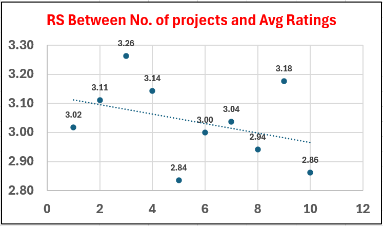

#### Top Performers by Department

Compares top-performing employees across departments.

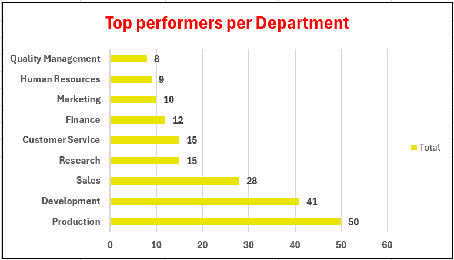

#### Average Salary by Department

Compares average salary across departments.

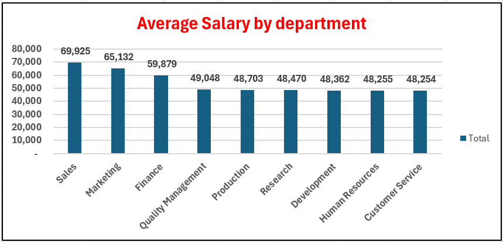

#### Employees Joined per Year

Shows hiring volume across joining years.

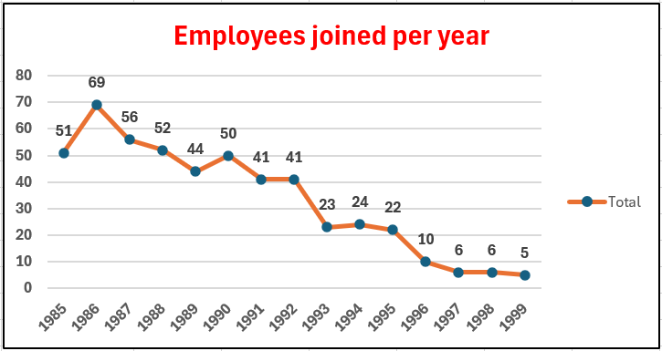

#### Recent Hiring by Department

Shows departmental hiring during the two most recent joining years.

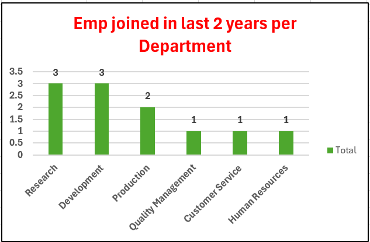

## SQL Analysis

### Database & Schema

The SQL analysis uses:

- `Emp_Info`
- `Dept_Info`

`Dept_Info.Dept_Id` is referenced by `Emp_Info.Dept_Id`.

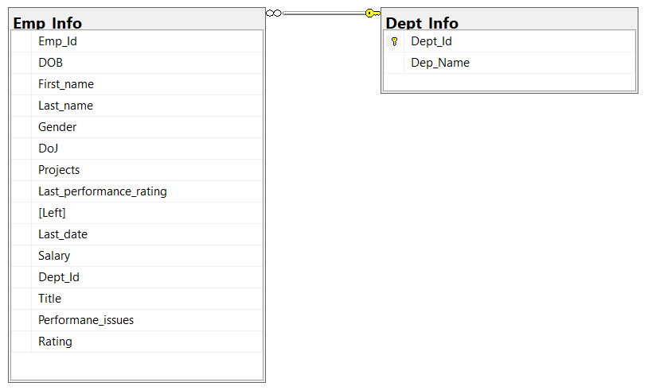

### Tools & Techniques

**Microsoft SQL Server:** `INNER JOIN`, `COUNT`, `AVG`, `DISTINCT`, `GROUP BY`, `HAVING`, `WHERE`, `LIKE`, `YEAR`, `DATEDIFF`, subqueries, `TOP`, `ORDER BY`.

### Analysis & Key Insights

SQL is used for employee/department joins, distinct-employee analysis, multi-department identification, tenure, attrition, performance-risk analysis, leadership, top performers, salary analysis, hiring trends, gender analysis, performance distribution, and highest earners.

Key results include **449 distinct employee IDs**, **51 repeated IDs**, **44 employees who left**, **456 current employees**, **29 leadership roles**, **188 S/A performers**, and **8 performance-risk employees**.

## Power BI Analysis

### Data Model

The Power BI model connects `Emp_Info` and `Dept_Info` through `Dept_Id`. It also contains two field-parameter tables for dynamic salary analysis:

- `Dynamic x axis`
- `Dynamic y axis`

### DAX & Calculated Fields

**Measures:** `Total_Employees`, `Total_Salary`, `Total_male_emp`, `Total_female_emp`, `Emp_currently_there`, `Emp_who_left`, `Top_performers`, `emp_with_perf_issues`, `Average_Salary`.

**Dynamic X-axis:** `Dep_Name`, `Gender`, `Last_performance_rating`, `Projects`, `Title`.

**Dynamic Y-axis:** `Total_Salary`, `Average_Salary`.

### Dashboard & Visualizations

#### Navigation

Provides navigation between the main Power BI report sections.

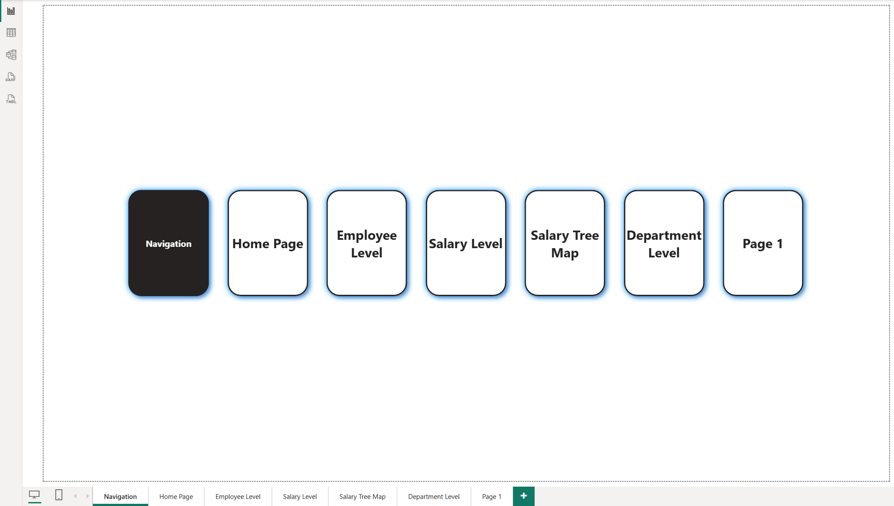

#### Home Page

Provides an overall HR view with workforce KPIs, gender distribution, salary by job title and department, hiring trends, and employee counts.

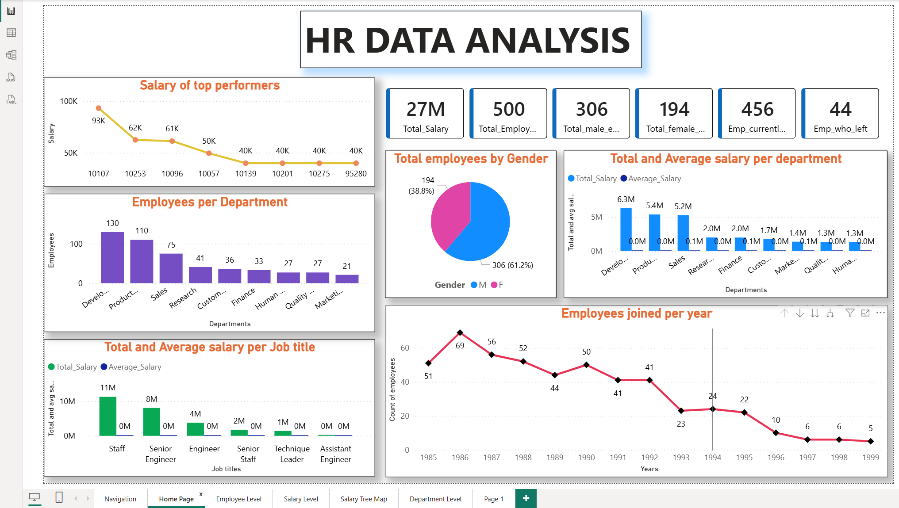

#### Employee Level

Analyzes gender, salary, performance ratings, employee-level salary, top performers by department, and employee count by job title.

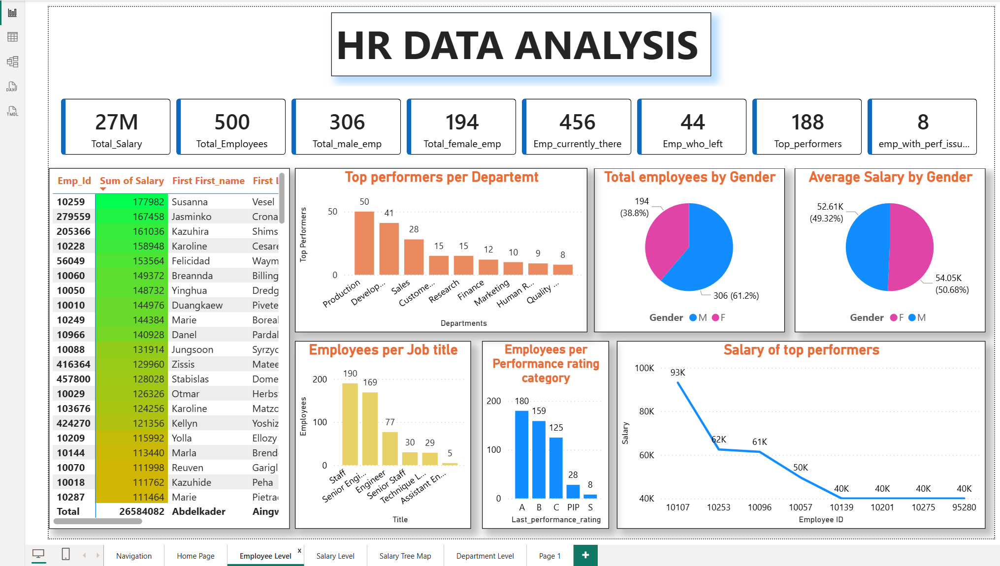

#### Salary Level

Uses dynamic X/Y field parameters to compare total and average salary by department, gender, performance rating, projects, or job title.

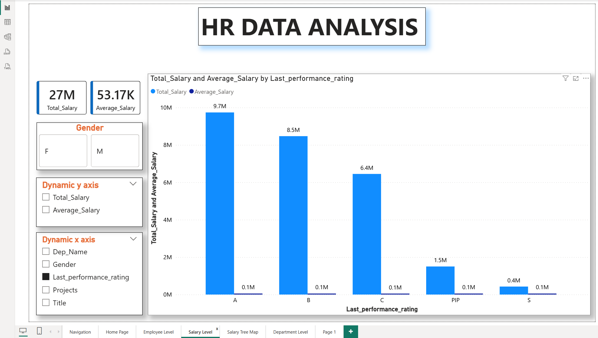

#### Salary Tree Map

Shows total salary hierarchically by department and employee.

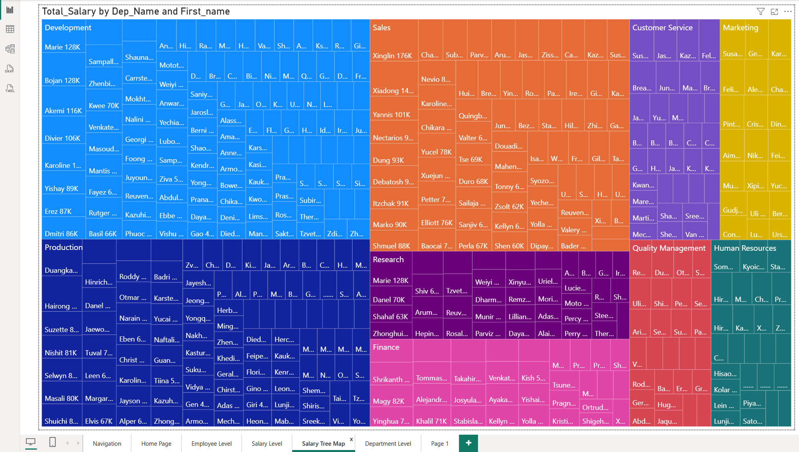

#### Department Level

Compares average/total salary, employee count, top performers, and performance issues by department, with gender, title, and rating filters.

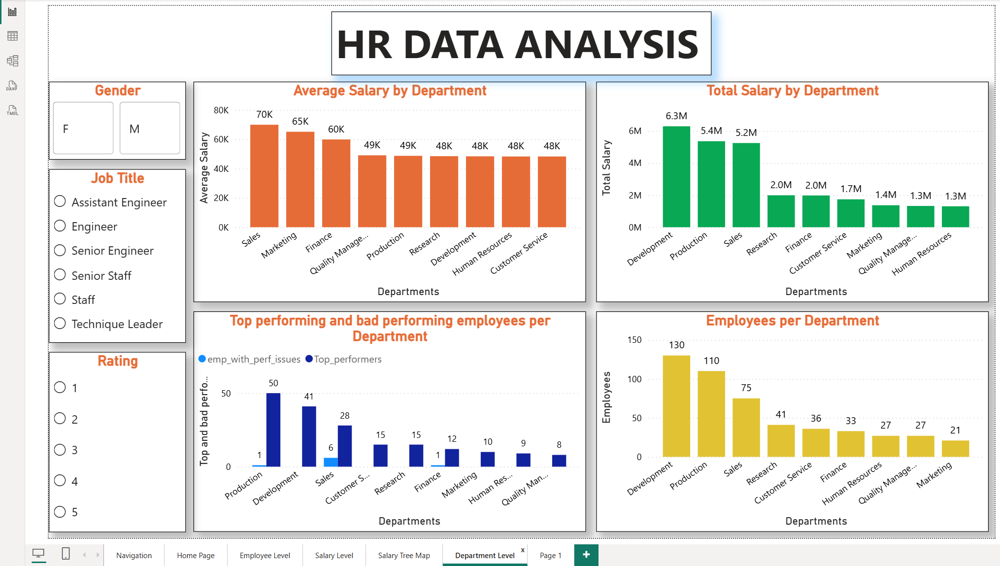

#### Total Salary per Job Title

Compares total salary across job titles.

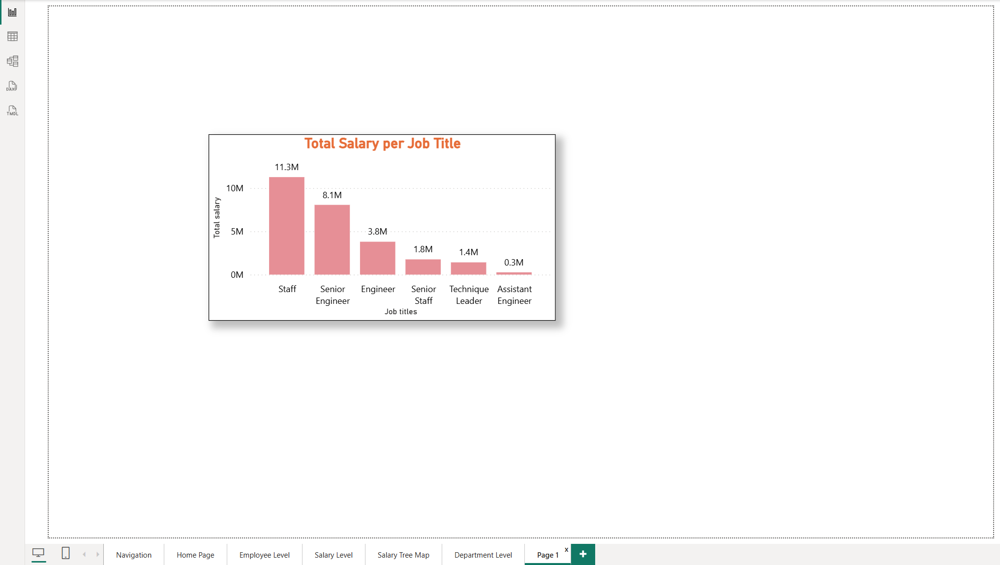

## End-to-End Workflow

```text
Excel
  ↓
Exploration, validation, preparation & summaries
  ↓
SQL Server
  ↓
Joins, filtering, aggregation & business analysis
  ↓
Power BI
  ↓
Data model, DAX, parameters, KPIs & interactive dashboards
```

## Project Structure

```text
HR Data Analysis - Excel, Sql, Powerbi/
│
├── Data/
│   ├── Emp_Info.csv
│   └── Dept_Info.csv
│
├── HR Data Analysis - excel/
│   └── HR Data Analysis excel.xlsx
│
├── HR Data Analysis - sql/
│   └── HR Data Analysis ssms.sql
│
├── HR Data Analysis - powerbi/
│   └── HR Data Analysis powerbi.pbix
│
├── Database/
│   └── HR_Analysis_Database.bak
│
├── Schema/
│   └── schema.png
│
├── Screenshots/
│   ├── excel/
│   │   ├── ss_1.png
│   │   ├── ss_2.png
│   │   ├── ss_3.png
│   │   ├── ss_4.png
│   │   └── ss_5.png
│   └── powerbi/
│       ├── ss_1.png
│       ├── ss_2.png
│       ├── ss_3.png
│       ├── ss_4.png
│       ├── ss_5.png
│       ├── ss_6.png
│       └── ss_7.png
│
├── HR Data Analysis Presentation - ppt/
│   └── HR Data Analysis presentation.pptx
│
└── README.md
```

## Conclusion

This project demonstrates a complete HR analytics workflow across **Excel, SQL, and Power BI**. It combines data preparation, relational querying, DAX-based analysis, KPI reporting, interactive filtering, and visualization to provide structured insights into workforce, salary, performance, attrition, hiring, and departmental patterns.

## Author

**Pranav Jella**
